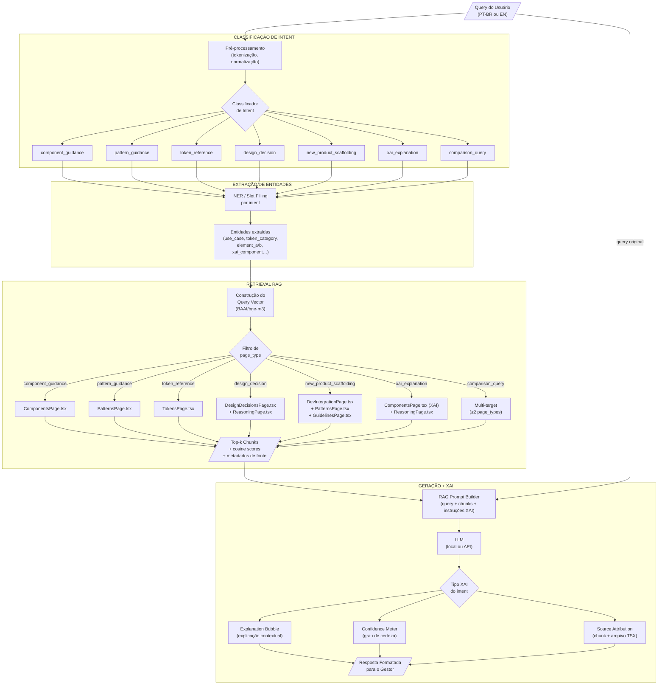
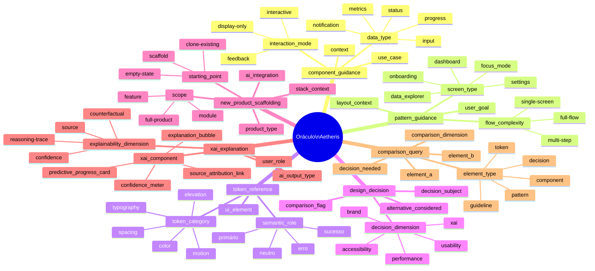

# Oráculo Inteligente — Mapa de Intents

> **Projeto:** Aetheris Design System — Oráculo Inteligente (XAI + RAG + UX)  
> **Autora:** Mariane B. S. Fontes  
> **Data:** Abril 2026  
> **Semana:** Semana 4 — Deliverable: Mapear intents principais  
> **Contexto:** TCC — Suporte à gestão ágil de projetos via Design System com IA explicável

---

## 1. Introdução

O mapeamento de intents é a espinha dorsal do sistema de diálogo do Oráculo Inteligente. Um intent representa a **intenção comunicativa do usuário** por trás de uma query em linguagem natural — ou seja, o que o gestor de projetos realmente quer saber, independente das palavras específicas que usa.

No contexto deste projeto, os intents operam como o primeiro estágio do pipeline RAG: antes de recuperar chunks do Aetheris, o sistema precisa classificar corretamente a intenção para direcionar o retrieval ao conjunto semântico de documentos mais relevante. Um intent mal classificado resulta em recuperação de contexto errado e, consequentemente, em respostas imprecisas ou inúteis.

Este documento define os **7 intents principais** da Beatrice, com especificação completa de entidades extraíveis, alvo de retrieval no corpus Aetheris, tipo de resposta XAI associada e exemplos bilíngues de queries.

---

## 2. Mapa Completo de Intents

### 2.1 `component_guidance`

| Atributo | Valor |
|----------|-------|
| **Nome** | `component_guidance` |
| **Prioridade** | Alta |
| **Página RAG alvo** | `ComponentsPage.tsx` (chunks: `components::*`) |
| **Tipo XAI** | Explanation Bubble + Source Attribution |

**Descrição:** O usuário quer saber qual componente do Aetheris usar para resolver um problema de interface específico. A query está centrada em uma necessidade funcional — exibir dados, capturar input, comunicar status — e o Oráculo deve retornar o nome do componente, seu propósito e quando usá-lo.

**Exemplos de queries — PT-BR:**
- "Qual componente devo usar para mostrar o progresso de uma sprint?"
- "Como exibo a confiança de uma predição da IA para o usuário?"
- "Que componente serve para notificar o usuário de uma ação concluída em background?"
- "Quero mostrar tendências de velocity ao longo do tempo. Qual componente uso?"
- "Como mostro que o sistema está carregando dados sem travar a tela?"

**Exemplos de queries — EN:**
- "Which component should I use to display AI prediction confidence?"
- "What's the right component for background task notifications?"
- "How do I show loading state without blocking the entire screen?"
- "Which component visualizes time-series metrics in a compact way?"

**Entidades extraídas:**

| Entidade | Tipo | Exemplo |
|----------|------|---------|
| `use_case` | string | "mostrar progresso de sprint", "exibir confiança da IA" |
| `data_type` | enum | metrics, status, input, notification, progress |
| `interaction_mode` | enum | display-only, interactive, feedback |
| `context` | string | "gestão ágil", "dashboard", "onboarding" |

---

### 2.2 `pattern_guidance`

| Atributo | Valor |
|----------|-------|
| **Nome** | `pattern_guidance` |
| **Prioridade** | Alta |
| **Página RAG alvo** | `PatternsPage.tsx` (chunks: `patterns::*`) |
| **Tipo XAI** | Explanation Bubble + Source Attribution |

**Descrição:** O usuário quer entender como estruturar, organizar ou compor uma tela ou fluxo completo — não um componente isolado, mas um padrão de layout e interação. A query envolve termos como "tela de", "fluxo de", "como montar", "como estruturar", "layout de".

**Exemplos de queries — PT-BR:**
- "Como devo estruturar um dashboard de gestão de projetos?"
- "Qual padrão uso para criar um fluxo de onboarding de novo produto?"
- "Como organizar uma tela de exploração de dados com filtros e gráficos?"
- "Qual a estrutura recomendada para uma tela de configurações?"
- "Como montar um padrão de foco total sem distrações para o usuário?"

**Exemplos de queries — EN:**
- "How should I structure a project management dashboard?"
- "What pattern works for a multi-step onboarding flow?"
- "How do I lay out a data exploration screen?"
- "What's the recommended pattern for a command palette?"

**Entidades extraídas:**

| Entidade | Tipo | Exemplo |
|----------|------|---------|
| `screen_type` | string | "dashboard", "onboarding", "data explorer", "settings" |
| `flow_complexity` | enum | single-screen, multi-step, full-flow |
| `user_goal` | string | "configurar produto", "explorar dados", "tomar decisão" |
| `layout_context` | enum | desktop, mobile, split-view |

---

### 2.3 `token_reference`

| Atributo | Valor |
|----------|-------|
| **Nome** | `token_reference` |
| **Prioridade** | Média |
| **Página RAG alvo** | `TokensPage.tsx` (chunks: `tokens::color_tokens`, `tokens::typography_tokens`, `tokens::motion_tokens`) |
| **Tipo XAI** | Source Attribution |

**Descrição:** O usuário busca um valor ou nome de token de design específico — cor, tipografia, espaçamento, animação — para aplicar em código ou em ferramenta de design. A query é geralmente direta e operacional, sem contexto de uso complexo.

**Exemplos de queries — PT-BR:**
- "Qual token de cor uso para estado de erro?"
- "Qual é o token de tipografia para títulos de nível H1?"
- "Que token de motion usar para transições de modal?"
- "Qual o valor do token de espaçamento para padding interno de card?"
- "Existe um token semântico para cor de sucesso no Aetheris?"

**Exemplos de queries — EN:**
- "What color token should I use for error states?"
- "Which typography token maps to the primary heading?"
- "What motion token applies to drawer open transitions?"
- "Is there a semantic token for brand primary color?"

**Entidades extraídas:**

| Entidade | Tipo | Exemplo |
|----------|------|---------|
| `token_category` | enum | color, typography, spacing, motion, elevation |
| `semantic_role` | string | "erro", "sucesso", "primário", "neutro", "destaque" |
| `ui_element` | string | "título", "card", "modal", "botão" |
| `output_format` | enum | css-var, design-token-name, hex-value |

---

### 2.4 `design_decision`

| Atributo | Valor |
|----------|-------|
| **Nome** | `design_decision` |
| **Prioridade** | Média |
| **Página RAG alvo** | `DesignDecisionsPage.tsx` (chunks: `design-decisions::*`) + `ReasoningPage.tsx` (chunks: `reasoning::*`) |
| **Tipo XAI** | Explanation Bubble + Confidence Meter + Source Attribution |

**Descrição:** O usuário quer entender o **porquê** de uma escolha de design feita pelo Aetheris — a racionalidade por trás de uma decisão de componente, padrão ou diretriz. É o intent com maior demanda de XAI, pois exige transparência sobre o raciocínio do sistema.

**Exemplos de queries — PT-BR:**
- "Por que o Aetheris usa botão primário em vez de link para ações principais?"
- "Por que a arquitetura neural foi escolhida em vez de uma abordagem clássica?"
- "Qual o raciocínio por trás do Confidence Meter — por que não usar só uma porcentagem?"
- "Por que o Aetheris separa componentes de XAI dos componentes gerais de UI?"
- "Qual foi a lógica de decisão para o padrão de Focus Mode?"

**Exemplos de queries — EN:**
- "Why does Aetheris use a primary button instead of a text link for main actions?"
- "What was the reasoning behind choosing a neural architecture?"
- "Why is the Confidence Meter designed the way it is instead of just showing a number?"
- "What rationale drove the Focus Mode pattern design?"

**Entidades extraídas:**

| Entidade | Tipo | Exemplo |
|----------|------|---------|
| `decision_subject` | string | "botão primário", "arquitetura neural", "Confidence Meter" |
| `alternative_considered` | string | "link de texto", "abordagem clássica", "porcentagem simples" |
| `decision_dimension` | enum | usability, accessibility, xai, performance, brand |
| `comparison_flag` | boolean | true (se "em vez de" / "vs." / "instead of") |

---

### 2.5 `new_product_scaffolding`

| Atributo | Valor |
|----------|-------|
| **Nome** | `new_product_scaffolding` |
| **Prioridade** | Alta |
| **Página RAG alvo** | `DevIntegrationPage.tsx` + `PatternsPage.tsx` + `ComponentsPage.tsx` + `GuidelinesPage.tsx` |
| **Tipo XAI** | Explanation Bubble + Source Attribution |

**Descrição:** O usuário quer um guia de como construir um novo produto, módulo ou feature do zero usando o Aetheris. A query implica **criação a partir do zero** e envolve múltiplas camadas do design system: quais padrões escolher primeiro, quais componentes incluir, quais tokens configurar e quais diretrizes respeitar.

**Exemplos de queries — PT-BR:**
- "Como começo a construir um novo módulo com o Aetheris?"
- "Qual o passo a passo para criar um novo produto com o design system?"
- "Por onde devo começar se quero criar um painel de analytics do zero?"
- "Quais são os primeiros componentes a configurar num projeto novo com Aetheris?"
- "Como estruturo um novo produto que usa IA integrada ao Aetheris?"

**Exemplos de queries — EN:**
- "How do I scaffold a new product module using Aetheris?"
- "What's the recommended starting point for a new Aetheris-based project?"
- "Which components and patterns should I set up first in a new product?"
- "How do I bootstrap a new analytics dashboard with the design system?"

**Entidades extraídas:**

| Entidade | Tipo | Exemplo |
|----------|------|---------|
| `product_type` | string | "módulo de sprints", "painel de analytics", "produto de IA" |
| `starting_point` | enum | empty-state, scaffold, clone-existing |
| `stack_context` | string | "React", "Vue", "design-only", "dev+design" |
| `ai_integration` | boolean | true (se o produto envolve IA preditiva / XAI) |
| `scope` | enum | feature, module, full-product |

---

### 2.6 `xai_explanation`

| Atributo | Valor |
|----------|-------|
| **Nome** | `xai_explanation` |
| **Prioridade** | Alta |
| **Página RAG alvo** | `ComponentsPage.tsx` (chunks XAI: `explanation_bubble`, `confidence_meter`, `source_attribution_link`, `predictive_progress_card`) + `ReasoningPage.tsx` + `DevIntegrationPage.tsx` |
| **Tipo XAI** | Explanation Bubble + Confidence Meter + Source Attribution |

**Descrição:** O usuário quer saber **como implementar explicabilidade de IA** em sua interface — quais componentes do Aetheris são específicos para XAI, como comunicar a confiança de uma predição ao usuário final, como atribuir fontes a decisões automáticas, ou como tornar o comportamento da IA transparente e auditável.

**Exemplos de queries — PT-BR:**
- "Como adiciono explicabilidade de IA à minha interface de gestão?"
- "Qual componente exibe a fonte de uma predição automática?"
- "Como mostro ao gestor por que a IA recomendou um determinado prazo?"
- "Quais são os componentes do Aetheris para tornar a IA explicável?"
- "Como uso o Confidence Meter e a Explanation Bubble juntos?"
- "Como implemento rastreabilidade de decisões da IA na interface?"

**Exemplos de queries — EN:**
- "How do I add AI explainability to my interface?"
- "Which component shows the source of an AI prediction?"
- "How do I display why the AI recommended a specific deadline?"
- "What Aetheris components support XAI patterns?"
- "How do I implement decision traceability in my product UI?"

**Entidades extraídas:**

| Entidade | Tipo | Exemplo |
|----------|------|---------|
| `xai_component` | enum | explanation_bubble, confidence_meter, source_attribution_link, predictive_progress_card |
| `ai_output_type` | string | "predição de prazo", "recomendação de recurso", "risco de atraso" |
| `explainability_dimension` | enum | confidence, source, reasoning-trace, counterfactual |
| `user_role` | enum | gestor, analista, stakeholder, end-user |
| `implementation_stage` | enum | design, dev, integration |

---

### 2.7 `comparison_query`

| Atributo | Valor |
|----------|-------|
| **Nome** | `comparison_query` |
| **Prioridade** | Média |
| **Página RAG alvo** | Variável — depende dos elementos comparados (qualquer chunk do corpus Aetheris) |
| **Tipo XAI** | Explanation Bubble + Source Attribution |

**Descrição:** O usuário quer entender a diferença entre dois ou mais elementos do Aetheris — componentes, padrões, tokens ou decisões. A query contém marcadores comparativos explícitos ("diferença entre", "vs.", "quando usar X e não Y", "qual a distinção"). O Oráculo deve recuperar chunks para ambos os elementos comparados e sintetizar as diferenças.

**Exemplos de queries — PT-BR:**
- "Qual a diferença entre o Toggle Switch e o Switch Control?"
- "Quando devo usar o padrão Timeline em vez do Data Explorer?"
- "Qual a distinção entre Explanation Bubble e Confidence Meter?"
- "Botão primário vs. Global FAB — quando usar cada um?"
- "Qual a diferença entre token de cor semântico e token primitivo?"
- "Focus Mode vs. Command Center — qual a diferença conceitual?"

**Exemplos de queries — EN:**
- "What's the difference between Toggle Switch and Switch Control?"
- "When should I use Timeline instead of Data Explorer?"
- "Explanation Bubble vs. Confidence Meter — what's the distinction?"
- "Primary action button vs. Global FAB — when to use each?"
- "What's the difference between a semantic color token and a primitive token?"

**Entidades extraídas:**

| Entidade | Tipo | Exemplo |
|----------|------|---------|
| `element_a` | string | "Toggle Switch", "padrão Timeline", "token semântico" |
| `element_b` | string | "Switch Control", "Data Explorer", "token primitivo" |
| `element_type` | enum | component, pattern, token, guideline, decision |
| `comparison_dimension` | string | "quando usar", "visual", "comportamento", "conceito" |
| `decision_needed` | boolean | true (se query pede recomendação de escolha) |

---

## 3. Tabela-Resumo dos 7 Intents

| # | Intent | Prioridade | RAG Alvo Principal | Tipo XAI | Palavras-chave gatilho |
|---|--------|------------|-------------------|----------|------------------------|
| 1 | `component_guidance` | Alta | `ComponentsPage.tsx` | Explanation Bubble + Source Attribution | "componente", "qual componente", "which component", "como exibir", "como mostrar" |
| 2 | `pattern_guidance` | Alta | `PatternsPage.tsx` | Explanation Bubble + Source Attribution | "padrão", "estrutura", "tela de", "fluxo de", "como montar", "layout" |
| 3 | `token_reference` | Média | `TokensPage.tsx` | Source Attribution | "token", "cor", "tipografia", "espaçamento", "motion", "valor de" |
| 4 | `design_decision` | Média | `DesignDecisionsPage.tsx` + `ReasoningPage.tsx` | Explanation Bubble + Confidence Meter + Source Attribution | "por que", "razão", "lógica", "decisão", "why", "rationale", "em vez de", "instead of" |
| 5 | `new_product_scaffolding` | Alta | `DevIntegrationPage.tsx` + `PatternsPage.tsx` | Explanation Bubble + Source Attribution | "novo produto", "do zero", "como começo", "scaffold", "bootstrap", "começar" |
| 6 | `xai_explanation` | Alta | `ComponentsPage.tsx` (XAI) + `ReasoningPage.tsx` | Explanation Bubble + Confidence Meter + Source Attribution | "explicabilidade", "XAI", "rastreabilidade", "confiança da IA", "fonte da predição", "transparência" |
| 7 | `comparison_query` | Média | Variável (≥2 chunks) | Explanation Bubble + Source Attribution | "diferença", "vs.", "versus", "distinção", "quando usar X e não Y", "difference between" |

---

## 4. Fluxo de Diálogo — Diagrama Mermaid

O fluxo abaixo representa o processamento completo de uma query desde a entrada do usuário até a resposta formatada com camadas XAI.



---

## 5. Diagrama de Intents e Sub-entidades — Mermaid

O diagrama abaixo exibe os 7 intents como nós centrais com suas entidades-filhas expandidas.



---

## 6. Matriz de Disambiguação de Intents

A matriz abaixo ajuda o classificador a distinguir intents que compartilham vocabulário superficialmente similar. Para cada par de intents potencialmente confundíveis, são listados os sinais linguísticos discriminantes.

### 6.1 Pares Ambíguos Identificados

| Par Ambíguo | Signal para Intent A | Signal para Intent B | Exemplo que resolve |
|-------------|---------------------|---------------------|---------------------|
| `component_guidance` vs. `pattern_guidance` | Foco em **elemento único** ("componente", "botão", "card"); pergunta "qual componente" | Foco em **composição/tela** ("tela de", "fluxo", "estrutura", "padrão", "layout"); pergunta "como montar/estruturar" | A: "Qual componente uso para notificação?" / B: "Como estruturo uma tela de notificações?" |
| `component_guidance` vs. `xai_explanation` | Pergunta sobre **uso geral** de qualquer componente; sem menção explícita a IA ou explicabilidade | Pergunta **especificamente sobre componentes XAI** (Explanation Bubble, Confidence Meter) ou sobre tornar a IA transparente | A: "Qual componente uso para mostrar métricas?" / B: "Qual componente mostra a confiança de uma predição da IA?" |
| `design_decision` vs. `comparison_query` | Pergunta **por que** algo foi escolhido; foco em **rationale histórico** do Aetheris; verbo "escolheu", "optou por", "decidiu" | Pergunta a **diferença prática** entre dois elementos; foco em **quando usar cada um**; marcadores "diferença", "vs.", "distinção" | A: "Por que o Aetheris escolheu botão primário e não link?" / B: "Qual a diferença entre botão primário e link?" |
| `pattern_guidance` vs. `new_product_scaffolding` | Pergunta sobre **uma tela ou fluxo específico** já existente; escopo **parcial** | Pergunta sobre **construção de um produto completo** do zero; escopo total; verbos "começo", "bootstrap", "scaffold", "criar um novo produto" | A: "Como estruturo uma tela de onboarding?" / B: "Como crio um novo produto de onboarding do zero com Aetheris?" |
| `token_reference` vs. `component_guidance` | Pergunta por **valor ou nome de token** (cor, tipografia, espaçamento); resposta é um **dado/variável CSS** | Pergunta por **componente a usar** para resolver um problema de UX; resposta é um **componente com comportamento** | A: "Qual token de cor uso para estado de erro?" / B: "Qual componente uso para comunicar erros ao usuário?" |
| `xai_explanation` vs. `design_decision` | Pergunta sobre **como implementar** XAI na interface do usuário final; foco em **execução técnica/de design** | Pergunta sobre **por que** o Aetheris tomou uma decisão de design relacionada a XAI; foco em **justificativa** | A: "Como adiciono um Confidence Meter na minha tela?" / B: "Por que o Aetheris escolheu o Confidence Meter e não só uma porcentagem?" |
| `comparison_query` vs. `component_guidance` | Presença **obrigatória** de dois elementos nomeados; marcadores comparativos explícitos | Apenas **um** elemento ou necessidade funcional identificada; sem marcador comparativo | A: "Diferença entre Toast Notification e Contextual Menu?" / B: "Qual componente uso para feedback de ação?" |

### 6.2 Regras de Prioridade para Resolução de Ambiguidade

Quando múltiplos intents têm score similar no classificador, aplicar as seguintes regras de desempate, em ordem de prioridade:

1. **Presença de dois elementos nomeados com marcador comparativo** → `comparison_query` (máxima especificidade)
2. **Presença de "por que" / "razão" / "rationale"** → `design_decision`
3. **Presença de "do zero" / "novo produto" / "scaffold"** → `new_product_scaffolding`
4. **Presença de vocabulário XAI** (confidence, explainability, rastreabilidade, prediction) + **"como implementar"** → `xai_explanation`
5. **Presença de "token" / nome de variável CSS** → `token_reference`
6. **Pergunta sobre uma tela/fluxo completo** → `pattern_guidance`
7. **Default para perguntas de escolha de elemento de UI** → `component_guidance`

### 6.3 Casos Especiais — Intents Compostos

Algumas queries do Oráculo envolvem **dois intents combinados**. Nesses casos, o sistema deve processar ambos sequencialmente:

| Caso | Estratégia |
|------|-----------|
| "Qual componente uso e por que o Aetheris o recomenda?" | `component_guidance` → `design_decision` (sequencial) |
| "Como estruturo meu dashboard e quais tokens de cor aplicar?" | `pattern_guidance` → `token_reference` (sequencial) |
| "Qual componente de XAI usar e como implementá-lo?" | `xai_explanation` → `component_guidance` (merge de retrieval) |
| "Qual a diferença entre X e Y e qual devo escolher para o meu caso?" | `comparison_query` → `component_guidance` ou `pattern_guidance` |

---

## 7. Cobertura dos Intents no Corpus Aetheris

A tabela abaixo mapeia quantos chunks do corpus indexado (54 total) são relevantes para cada intent, indicando a cobertura e potenciais gaps de retrieval.

| Intent | Chunks Primários | Chunks Secundários | Total Coberto | Cobertura | Gap Identificado |
|--------|-----------------|-------------------|---------------|-----------|-----------------|
| `component_guidance` | 18 (components) | 2 (foundations) | 20 | 37% do corpus | 5 componentes thin sem `when_to_use` |
| `pattern_guidance` | 11 (patterns) | 3 (guidelines) | 14 | 26% do corpus | `settings_&_config` thin (1 campo) |
| `token_reference` | 3 (tokens) | 2 (foundations color/typography) | 5 | 9% do corpus | Nenhum campo semântico estruturado nos tokens |
| `design_decision` | 2 (decisions) | 3 (reasoning) | 5 | 9% do corpus | Apenas 2 decisões documentadas; corpus limitado |
| `new_product_scaffolding` | 4 (dev-integration) | 11 (patterns) + 3 (guidelines) | 18 | 33% do corpus | `dev-integration` sem campos semânticos |
| `xai_explanation` | 4 (XAI components) | 3 (reasoning) | 7 | 13% do corpus | XAI components com poucos campos preenchidos |
| `comparison_query` | Variável | Variável | Até 54 | 100%* | *Depende dos elementos comparados |

> **Nota:** A cobertura de `design_decision` é o gap mais crítico. Com apenas 2 chunks de decisões documentadas, o Oráculo tem capacidade limitada para responder perguntas de rationale de forma robusta. Recomenda-se expandir `DesignDecisionsPage.tsx` com pelo menos 8–10 decisões adicionais para viabilizar respostas confiáveis neste intent.

---

## 8. Considerações para Implementação

### 8.1 Classificação de Intents

A classificação pode ser implementada em três camadas de complexidade crescente:

| Abordagem | Complexidade | Adequação ao projeto |
|-----------|-------------|---------------------|
| **Regras baseadas em keywords** | Baixa | Protótipo inicial; suficiente para 80% dos casos usando as palavras-gatilho da Seção 3 |
| **Zero-shot com LLM** | Média | Usar o próprio LLM do pipeline para classificar antes de gerar resposta; boa flexibilidade |
| **Fine-tuned classifier** | Alta | Modelo treinado em exemplos rotulados; máxima precisão; não necessário para TCC |

Para o escopo deste TCC, recomenda-se a abordagem de **zero-shot com LLM** — o modelo recebe a query e um prompt de classificação com os 7 intents descritos e retorna o intent mais provável com score de confiança.

### 8.2 Prompt de Classificação (Template)

```python
INTENT_CLASSIFIER_PROMPT = """
Você é um classificador de intenções para a Beatrice, assistente do Aetheris Design System.

Classifique a query abaixo em exatamente um dos 7 intents:
- component_guidance: usuário quer saber qual componente usar
- pattern_guidance: usuário quer estruturar uma tela ou fluxo
- token_reference: usuário busca um token de design (cor, tipografia, espaçamento, motion)
- design_decision: usuário quer entender por que o Aetheris fez uma escolha
- new_product_scaffolding: usuário quer criar um produto/módulo do zero
- xai_explanation: usuário quer implementar explicabilidade de IA na interface
- comparison_query: usuário quer comparar dois elementos do Aetheris

Query: {query}

Responda em JSON: {{"intent": "<intent_name>", "confidence": <0.0-1.0>, "entities": {{...}}}}
"""
```

### 8.3 Mapeamento Intent → Filtro ChromaDB

```python
INTENT_TO_PAGE_TYPE_FILTER = {
    "component_guidance":      {"page_type": {"$in": ["component"]}},
    "pattern_guidance":        {"page_type": {"$in": ["pattern"]}},
    "token_reference":         {"page_type": {"$in": ["token", "foundation"]}},
    "design_decision":         {"page_type": {"$in": ["decision", "reasoning"]}},
    "new_product_scaffolding": {"page_type": {"$in": ["integration", "pattern", "guideline"]}},
    "xai_explanation":         {"page_type": {"$in": ["component", "reasoning", "integration"]}},
    "comparison_query":        None,  # sem filtro — busca em todo o corpus
}
```

---

## 9. Referências Internas do Projeto

| Documento | Relevância para este mapa |
|-----------|--------------------------|
| `rag/pipeline-specs.md` | Especificação do pipeline RAG que consome este mapa de intents |
| `rag/component-map.md` | Cobertura detalhada dos 54 chunks que alimentam o retrieval por intent |
| `rag/embedding-model-justification.md` | Justificativa do modelo BGE-M3 para suporte cross-lingual PT-BR / EN |
| `ComponentsPage.tsx` | Fonte primária de `component_guidance` e `xai_explanation` |
| `PatternsPage.tsx` | Fonte primária de `pattern_guidance` e secundária de `new_product_scaffolding` |
| `TokensPage.tsx` | Fonte exclusiva de `token_reference` |
| `DesignDecisionsPage.tsx` | Fonte primária de `design_decision` |
| `ReasoningPage.tsx` | Fonte secundária de `design_decision` e `xai_explanation` |
| `DevIntegrationPage.tsx` | Fonte primária de `new_product_scaffolding` |
