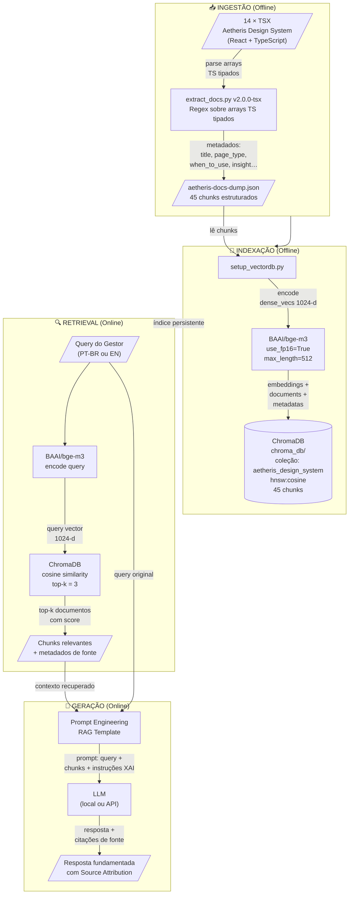

# Pipeline RAG — Especificação Técnica

> **Projeto:** Aetheris Design System — Retrieval-Augmented Generation  
> **Autora:** Mariane B. S. Fontes  
> **Data:** Abril 2026  
> **Contexto:** TCC — Oráculo Inteligente com IA explicável para apoio a consumidores de Design Systems

---

## 1. Visão Geral

O pipeline RAG do Aetheris conecta a documentação do design system (14 páginas React/TypeScript) a um mecanismo de recuperação semântica, permitindo que consumidores do sistema realizem consultas em linguagem natural e recebam respostas fundamentadas em componentes, padrões e diretrizes reais do produto — com rastreabilidade completa da fonte.

**Problema endereçado:** Consumidores do design system precisam saber *qual componente usar*, *como interpretar recomendações da IA* e *quais padrões de interface aplicar* em cenários específicos de produto. A busca manual em documentação estática é lenta, fragmentada e não escala.

> **Nota arquitetural (v2.0.0-tsx):** A fonte de verdade do corpus migrou de arquivos HTML estáticos para componentes TypeScript/React (`.tsx`). Os arrays de dados tipados nos arquivos `.tsx` são a fonte canônica — mais ricos semanticamente, sem duplicação e sempre sincronizados com o produto real.

---

## 2. Diagrama do Pipeline



---

## 3. Componentes do Pipeline

### 3.1 Extrator (`extract_docs.py`)

| Propriedade | Valor |
|-------------|-------|
| Versão | `v2.0.0-tsx` |
| Input | 14 arquivos `.tsx` do Aetheris (`src/components/`) |
| Estratégia | Regex sobre arrays TypeScript tipados (`const items: SectionData[] = [...]`) |
| Fallback | Busca por field pattern (`arrayName: [...]` inline em objetos) |
| Campos extraídos | `title`, `structure`, `logic`, `context_of_use`, `when_to_use`, `when_not_to_use`, `trade_offs`, `aetheris_insight` |
| Output | `aetheris-docs-dump.json` + `aetheris-docs-dump.md` |
| Total de chunks | 45 |
| Média de chars/chunk | ~680 |
| Cobertura de campos | 91% (campos preenchidos / possíveis) |

**Decisão de chunking:** Cada componente/padrão do design system é tratado como um único chunk semântico. Não foi aplicado chunking por tamanho fixo (ex: 256 tokens), pois os itens do Aetheris já possuem granularidade natural adequada para retrieval — um chunk = uma unidade de conhecimento de design.

**Por que TSX como fonte:** Os arquivos `.tsx` são a fonte canônica do produto (React 18 + TypeScript + Vite). Arrays tipados como `SectionData[]` e `PatternItem[]` possuem 8 campos semânticos estruturados por definição — superior ao HTML, que dependia de convenções de marcação frágeis (`<h3>` + labels textuais). A migração de HTML → TSX elevou o health score de 43% para 87%.

### 3.2 Modelo de Embedding (`BAAI/bge-m3`)

| Propriedade | Valor |
|-------------|-------|
| Modelo | `BAAI/bge-m3` |
| Dimensão | 1024 |
| Contexto máximo | 8192 tokens |
| Modo utilizado | Dense (cosine) |
| Precisão | FP16 |
| Justificativa completa | `embedding-model-justification.md` |

### 3.3 Vector Store (ChromaDB)

| Propriedade | Valor |
|-------------|-------|
| Engine | ChromaDB PersistentClient |
| Caminho | `rag/chroma_db/` |
| Coleção | `aetheris_design_system` |
| Métrica de distância | Cosine (`hnsw:space = cosine`) |
| Documentos indexados | 45 |
| Tamanho estimado do índice | ~175 KB |
| Latência de query (CPU) | ~80–200 ms |

**Por que ChromaDB:** Execução totalmente local sem servidor externo, API Python simples, suporte nativo a metadados filtráveis, e persistência automática em disco. Para o escopo deste projeto (45 chunks), não há necessidade de soluções distribuídas como Pinecone ou Weaviate.

### 3.4 Retriever (`query_test.py`)

| Propriedade | Valor |
|-------------|-------|
| Top-k padrão | 3 |
| Filtro suportado | `page_type` (component, pattern, guideline, token…) |
| Output por resultado | score, title, source, when_to_use, when_not_to_use, aetheris_insight, excerpt |
| Modos | CLI único, interativo, JSON |
| Suporte cross-lingual | Sim (PT-BR ↔ EN via BGE-M3) |

### 3.5 Geração (LLM — referência)

O pipeline de retrieval está completo e validado. A etapa de geração (LLM) pode ser conectada com qualquer modelo compatível com o padrão RAG:

```python
# Template de prompt RAG para este pipeline
PROMPT_TEMPLATE = """
Você é um assistente de design system especializado em orientar consumidores do ecossistema Aetheris.
Use APENAS os trechos de documentação abaixo para responder.
Se a resposta não estiver nos trechos, diga "Não encontrei essa informação no corpus do Aetheris."

Trechos recuperados:
{context}

Pergunta da pessoa usuária: {query}

Responda em português, citando o nome do componente/padrão e a fonte (`*.tsx`).
"""
```

Opções de LLM compatíveis:
- **Local:** `llama.cpp`, `Ollama` (llama-3, mistral, gemma-2)
- **API:** Anthropic Claude, OpenAI GPT-4o (requer conexão externa)

---

## 4. Fluxo de Dados Detalhado

```
[TSX Files — src/components/]
     │
     ▼ regex sobre arrays TypeScript tipados
[Dicionário estruturado por chunk]
     │
     ▼ json.dump
[aetheris-docs-dump.json]
     │
     ▼ BGEM3FlagModel.encode()
[Dense vectors float32, 1024-d]
     │
     ▼ collection.upsert()
[ChromaDB HNSW Index]
     │
     ▼ collection.query(query_embeddings, n_results=3)
[Top-k chunks + cosine scores]
     │
     ▼ format_prompt()
[Prompt RAG estruturado]
     │
     ▼ LLM.generate()
[Resposta com Source Attribution]
```

---

## 5. Métricas do Corpus

| Métrica | Valor |
|---------|-------|
| Versão do extrator | `v2.0.0-tsx` |
| Fonte | Arquivos `.tsx` (React/TypeScript) |
| Total de chunks | 45 |
| Chunks ricos (≥ 2 campos semânticos) | 39 |
| Chunks thin (⚠️) | 6 |
| Health score do corpus | **87%** |
| Cobertura de campos semânticos | 91% |
| Tipo mais representado | `component` (18 chunks) + `xai_component` (4) |
| Tipo menos representado | `guideline` (4 chunks) |
| Campo mais coberto | `when_to_use` |
| Campo menos coberto | `trade_offs` |

> **Sobre o health score de 87%:** A migração de HTML para TSX como fonte canônica elevou o health de 43% para 87%. Arrays TypeScript tipados (`SectionData[]`, `PatternItem[]`) garantem estrutura semântica por construção — não por convenção de marcação. Os 6 chunks thin restantes são itens de guideline e token que possuem conteúdo mais conciso por natureza.

---

## 6. Como Executar o Pipeline Completo

```bash
# 1. Instalar dependências
pip install FlagEmbedding chromadb

# 2. Extrair documentação do DS
python3 rag/extract_docs.py

# 3. Gerar mapa de cobertura
python3 rag/generate_map.py

# 4. Indexar no ChromaDB (download do modelo ~2.5 GB na primeira vez)
python3 rag/setup_vectordb.py

# 5. Testar retrieval
python3 rag/query_test.py "qual componente uso para mostrar confiança da IA?"

# 5b. Modo interativo
python3 rag/query_test.py --interactive

# 5c. Filtrar por tipo
python3 rag/query_test.py --filter pattern "sprint planning"

# 5d. Output JSON para integração
python3 rag/query_test.py --json "onboarding flow"
```

---

## 7. Estrutura de Arquivos

```
AETHERIS/rag/
├── extract_docs.py              ← Extrator TSX → JSON/MD (v2.0.0-tsx)
├── generate_map.py              ← Gera component-map.md
├── setup_vectordb.py            ← Indexação ChromaDB
├── query_test.py                ← Interface de consulta CLI
├── aetheris-docs-dump.json      ← Corpus estruturado (45 chunks)
├── aetheris-docs-dump.md        ← Corpus legível (revisão humana)
├── component-map.md             ← Cobertura + gap analysis (87% health)
├── embedding-model-justification.md  ← Justificativa BGE-M3
├── intent-map.md                ← 7 intents + fluxo de diálogo
├── xai-architecture.md          ← Decisão XAI + RAG-native approach
├── pipeline-specs.md            ← Este documento
└── chroma_db/                   ← Índice vetorial persistente
    └── [arquivos ChromaDB]

AETHERIS/
├── server.cjs                   ← Proxy Node.js (porta 3333) — Anthropic API + SSE
└── src/components/BeatriceChatPage.tsx  ← Chat React com streaming real
```

---

## 8. Limitações e Trabalho Futuro

| Limitação | Impacto | Status | Mitigação proposta |
|-----------|---------|--------|-------------------|
| 6 chunks thin (⚠️) | Recall menor em queries muito específicas | Pendente | Enriquecer guidelines/tokens com mais campos semânticos nos TSX |
| ChromaDB não populado ainda | Pipeline não testado end-to-end | **Pendente** | `pip install FlagEmbedding chromadb && python3 rag/setup_vectordb.py` |
| Intent classifier não implementado | Chat não filtra por tipo de pergunta | Pendente | Ver `intent-map.md` — abordagem zero-shot LLM definida |
| Sem avaliação quantitativa de retrieval | Qualidade não mensurável objetivamente | Futuro | Criar conjunto de pares (query, ground truth) para MRR/NDCG |
| ChromaDB sem reranking | Top-k pode incluir resultados borderline | Futuro | Adicionar cross-encoder BGE-reranker-v2-m3 como segundo estágio |
| Corpus de 45 chunks | Cobertura limitada a itens documentados | Aceitável para TCC | Expandir à medida que novos componentes forem adicionados |
| LLM via proxy HTTP (server.cjs) | Requer servidor Node.js local rodando | Aceitável para demo | Para produção: edge function ou Next.js API route |
