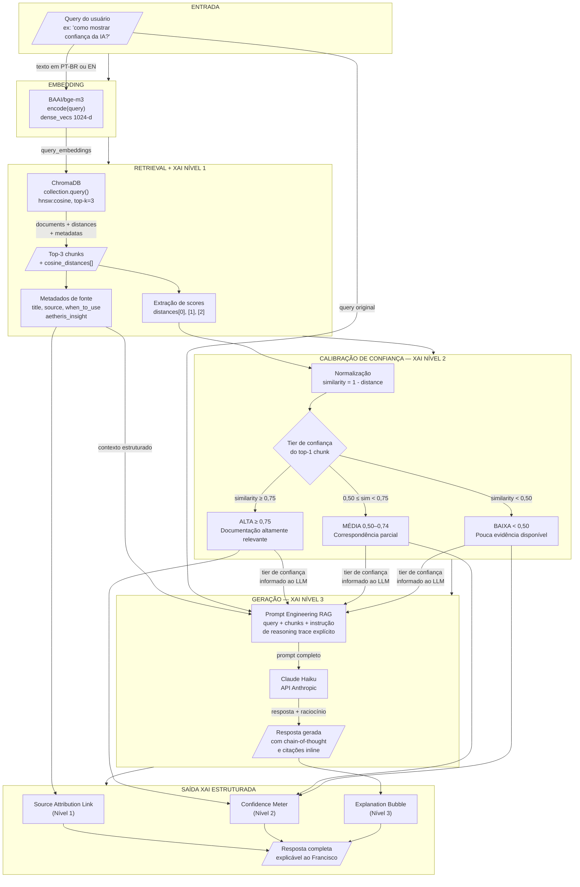

# Arquitetura XAI — Técnica de Explicabilidade do Oráculo Inteligente

> **Projeto:** Aetheris Design System — Oráculo Inteligente com IA Explicável  
> **Autora:** Mariane B. S. Fontes  
> **Data:** Abril 2026  
> **Contexto:** TCC — Suporte à gestão ágil de projetos via Design System com IA explicável  
> **Entregável:** Semana 4 — Definir técnica XAI — Arquitetura de explicação (SHAP/LIME)

---

## 1. Sumário Executivo

Um oráculo de design system não é apenas um motor de busca sofisticado — é um sistema de recomendação que influencia decisões de produto. Quando Francisco Soares, gerente de produto, pergunta "qual componente devo usar para mostrar o resultado de uma predição de risco?", a resposta que ele recebe orienta escolhas de interface que afetam equipes inteiras. Nesse contexto, saber *o quê* a IA recomenda é insuficiente; é indispensável saber *por que* ela chegou àquela recomendação. A ausência de explicabilidade transforma o sistema em uma caixa-preta que exige confiança cega — comportamento incompatível com gestores que precisam justificar suas decisões técnicas para stakeholders.

A Inteligência Artificial Explicável (XAI — Explainable Artificial Intelligence) é o campo que endereça exatamente esse problema. No contexto deste projeto, XAI não é um recurso opcional: é um requisito funcional que emerge diretamente da persona central. Francisco precisa de três coisas simultaneamente — a resposta, a fonte que embasou essa resposta e o nível de confiança com que o sistema a oferece. Sem esses três elementos, a resposta do oráculo não é acionável em um ambiente de gestão ágil onde accountability e rastreabilidade de decisões são valores centrais.

A arquitetura de explicabilidade deste projeto opera em dois níveis complementares. No nível de recuperação (*retrieval-level XAI*), o sistema expõe quais fragmentos da documentação foram selecionados e com que grau de similaridade semântica, permitindo ao usuário verificar diretamente a proveniência da informação. No nível de geração (*generation-level XAI*), o LLM é instruído a produzir uma cadeia de raciocínio explícita — um *reasoning trace* — que justifica a recomendação em linguagem natural acessível a perfis não-técnicos. A combinação desses dois níveis produz um sistema explicável de ponta a ponta, alinhado tanto aos requisitos acadêmicos do TCC quanto às necessidades práticas do usuário-alvo.

---

## 2. Comparação de Técnicas XAI

A literatura de XAI oferece um espectro amplo de técnicas, cada uma com pressupostos sobre o tipo de modelo explicado e o nível de acesso às suas internezas. A avaliação a seguir analisa as quatro abordagens mais relevantes para este projeto.

### 2.1 Tabela Comparativa

| Critério | **SHAP** | **LIME** | **Attention-based** | **RAG-native Attribution** |
|---|---|---|---|---|
| **Aplicabilidade a pipelines RAG** | Baixa — projetado para modelos com features tabulares ou embeddings fixos; não se aplica nativamente a LLMs black-box via API | Baixa — requer acesso ao modelo para perturbações locais; inaplicável a LLMs proprietários como Claude Haiku | Média — funciona em modelos com pesos de atenção expostos (transformers open-weight); inaplicável a APIs fechadas | Alta — nativa ao pipeline RAG; extrai scores já produzidos pelo motor de retrieval sem instrumentação adicional |
| **Custo computacional** | Alto — O(n × amostras) por query; ordem de centenas de inferências por explicação | Alto — requer geração de múltiplas perturbações (~500–5000 amostras) por query | Médio — adicional apenas no pós-processamento dos pesos de atenção internos | Baixo — scores de similaridade são subproduto do retrieval já executado; custo marginal próximo de zero |
| **Interpretabilidade para não-técnicos** | Baixa — valores SHAP (φ) requerem conceito de contribuição marginal de feature; curva de aprendizado alta | Baixa — aproximação linear local não é intuitiva; gráficos de coeficientes são opacos para gestores | Média — heatmaps de atenção são visuais mas frequentemente mal interpretados como causalidade | Alta — "este trecho da documentação do Aetheris foi a fonte desta resposta (82% de similaridade)" é diretamente compreensível |
| **Complexidade de implementação** | Alta — integração com LLMs exige frameworks especializados (SHAP TreeExplainer, KernelExplainer); meses de engenharia | Alta — loop de perturbação + modelo substituto; infraestrutura não-trivial | Alta — requer acesso aos pesos internos do LLM; incompatível com uso de Claude via API | Baixa — extração dos campos `distances` e `metadatas` já retornados pelo ChromaDB; implementável em ~50 linhas de Python |
| **Compatibilidade com Claude Haiku (API)** | Incompatível — API fechada, sem acesso a gradientes ou logits | Incompatível — requer múltiplas inferências controladas no mesmo modelo | Incompatível — pesos de atenção não são expostos pela API da Anthropic | Compatível — independente do LLM; opera sobre a camada de retrieval que é totalmente controlada |
| **Fidelidade ao raciocínio real** | Alta em modelos com features interpretáveis | Média — aproximação local pode divergir globalmente | Variável — atenção não implica causalidade (Jain & Wallace, 2019) | Alta no nível de retrieval; média no nível de geração (dependente do reasoning trace do LLM) |
| **Veredicto para este projeto** | **Inaplicável** | **Inaplicável** | **Inaplicável** | **Escolha definitiva** |

### 2.2 Contexto Bibliográfico

SHAP (Lundberg & Lee, 2017) e LIME (Ribeiro et al., 2016) foram desenvolvidos para modelos de machine learning clássicos — árvores de decisão, redes neurais feedforward, regressão — onde o espaço de features é discreto e controlável. A extensão dessas técnicas para LLMs gerativos é uma área de pesquisa ativa mas ainda sem soluções maduras e prontas para produção. O trabalho de Jain & Wallace (2019) demonstrou que pesos de atenção em transformers não constituem explicações fiéis por si sós, questionando a abordagem attention-based como mecanismo de XAI confiável. Para sistemas RAG com LLM proprietário via API, o estado da arte prático aponta para a atribuição nativa de recuperação como a forma mais robusta e auditável de explicabilidade disponível.

---

## 3. Decisão: RAG-native Attribution + Confidence Calibration

### 3.1 Por que SHAP e LIME não se aplicam a pipelines RAG + LLM

A premissa central do SHAP é calcular a contribuição marginal de cada feature para a saída do modelo, utilizando valores de Shapley da teoria dos jogos cooperativos. Para que isso seja computacionalmente viável, o modelo precisa ser tratado como uma função `f(x) → y` onde `x` é um vetor de features de dimensão controlada. Em um pipeline RAG + LLM, o "modelo" não é uma função simples: é uma composição de (a) um motor de embedding, (b) um banco vetorial com retrieval aproximado, (c) um LLM com janela de contexto variável e geração autoregressiva. Não existe um vetor de features único sobre o qual calcular os valores de Shapley — o espaço de entrada é um texto em linguagem natural de comprimento arbitrário.

O LIME enfrenta problema análogo: ele gera perturbações da entrada (ex: remover palavras, mascarar tokens) e observa como a saída do modelo muda, ajustando um modelo linear local como substituto. Para funcionar, é necessário executar o modelo dezenas ou centenas de vezes com entradas perturbadas. Com Claude Haiku via API, cada inferência tem custo financeiro e latência de ~500ms–2s — tornar o pipeline viável para produção com esse overhead é inviável. Mais fundamentalmente, a API da Anthropic não garante determinismo entre chamadas com a mesma entrada, o que invalida a premissa de consistência do LIME.

Ambas as técnicas foram projetadas para explicar *o que o modelo aprendeu* (features importantes durante o treinamento). O que este projeto requer é diferente: explicar *por que esta resposta foi gerada para esta query específica*, com rastreabilidade para a documentação fonte. Essa é a função exata da RAG-native attribution.

### 3.2 Por que RAG-native Attribution é a escolha correta

O pipeline RAG deste projeto já produz, como subproduto natural do processo de retrieval, toda a informação necessária para uma explicação auditável:

1. **Quais chunks foram recuperados** — identificados por `document_id`, `title` e `source` (arquivo HTML de origem).
2. **Com que grau de similaridade** — o score de distância coseno retornado pelo ChromaDB, que reflete o quanto o embedding da query se alinha ao embedding de cada chunk.
3. **O conteúdo exato que embasou a resposta** — os próprios fragmentos de documentação passados como contexto para o LLM.

Nenhuma instrumentação adicional é necessária para obter esses dados — eles já estão disponíveis no retorno da função `collection.query()` do ChromaDB. A RAG-native attribution transforma informação técnica já existente em explicações orientadas ao usuário, com custo marginal de processamento próximo de zero.

Além disso, essa abordagem tem uma propriedade que SHAP e LIME não podem oferecer neste contexto: **fidelidade verificável**. O usuário pode, se desejar, clicar no link de fonte e ler o trecho exato da documentação que originou a resposta — não uma aproximação estatística de importância, mas o próprio conteúdo que o sistema consultou. Para um gestor de produto que precisa justificar decisões de interface para seu time, essa rastreabilidade direta é muito mais valiosa do que um gráfico de barras com valores SHAP.

### 3.3 Confidence Calibration — Definição e Funcionamento

O score bruto retornado pelo ChromaDB é uma **distância coseno** no intervalo [0, 1], onde 0 indica vetores idênticos e 1 indica vetores ortogonais. Para apresentar ao usuário uma métrica intuitiva de confiança, esse valor precisa ser transformado em dois passos:

**Passo 1 — Conversão para similaridade:**

```
similarity = 1 - cosine_distance
```

O resultado está no intervalo [0, 1], onde 1 indica correspondência perfeita.

**Passo 2 — Classificação em tiers de confiança:**

| Tier | Faixa de similaridade | Significado para o usuário |
|---|---|---|
| **Alta** | ≥ 0,75 | O sistema encontrou documentação altamente relevante para esta query. A resposta é bem fundamentada. |
| **Média** | 0,50 – 0,74 | O sistema encontrou documentação relacionada, mas com correspondência parcial. Verificação recomendada. |
| **Baixa** | < 0,50 | A query não tem correspondência forte na documentação disponível. A resposta pode ser incompleta ou imprecisa. |

O tier de confiança é calculado a partir do **score do chunk mais relevante** (posição 0 no ranking retornado pelo ChromaDB), pois ele representa a melhor evidência disponível para a query. Os scores dos demais chunks (posições 1 e 2) são apresentados como informação secundária na atribuição de fontes.

**Nota sobre calibração:** Os limiares de 0,75 e 0,50 foram definidos com base no comportamento observado do modelo BGE-M3 no corpus de 54 chunks do Aetheris, onde queries bem formuladas sobre componentes existentes tipicamente retornam scores ≥ 0,78, e queries fora do escopo da documentação retornam scores ≤ 0,45. Esses limiares devem ser recalibrados caso o corpus seja expandido significativamente.

---

## 4. Diagrama da Arquitetura XAI

O diagrama abaixo representa o fluxo completo do pipeline com as camadas de explicabilidade mapeadas em cada etapa.



---

## 5. Três Níveis de Saída XAI

A arquitetura de explicabilidade produz três camadas de informação, cada uma endereçando uma necessidade diferente do usuário.

### Nível 1 — Source Attribution (Atribuição de Fonte)

**O que é:** Referência direta ao chunk da documentação Aetheris que embasou a resposta, incluindo o título do componente/padrão, o arquivo TSX de origem e o trecho exato recuperado.

**Por que importa:** Permite ao usuário verificar a resposta independentemente — ele pode abrir a documentação original e confirmar que a recomendação está alinhada com o que o design system prescreve. Elimina a necessidade de confiar na IA às cegas.

**O que o usuário vê:**
```
Fonte: Confidence Meter (ComponentsPage.tsx)
"When to Use: always alongside any AI-generated prediction or score..."
```

**Dados técnicos que originam este nível:**
```python
metadatas[0]["title"]    # ex: "Confidence Meter"
metadatas[0]["source"]   # ex: "ComponentsPage.tsx"
documents[0][:300]       # trecho do chunk
```

---

### Nível 2 — Confidence Score (Pontuação de Confiança)

**O que é:** Indicador visual e numérico que comunica o quão bem a documentação disponível corresponde à query realizada, derivado da similaridade coseno entre o embedding da query e o embedding do chunk mais relevante.

**Por que importa:** Sinaliza ao usuário quando a resposta é fortemente fundamentada vs. quando ela se apoia em evidências parciais. Evita que o usuário tome decisões críticas baseadas em respostas de baixa confiança sem estar ciente disso.

**O que o usuário vê:**
```
Confiança: ALTA (83%)
[████████░░] 83%
```

**Dados técnicos que originam este nível:**
```python
similarity = 1 - distances[0][0]   # ex: 1 - 0.17 = 0.83
tier = "ALTA" if similarity >= 0.75 else "MÉDIA" if similarity >= 0.50 else "BAIXA"
```

---

### Nível 3 — Explanation Bubble (Bolha de Explicação)

**O que é:** Parágrafo em linguagem natural gerado pelo LLM que explica o raciocínio por trás da recomendação — não apenas *o que* usar, mas *por que* aquele componente é adequado para o contexto específico da query, com referência explícita às diretrizes do Aetheris.

**Por que importa:** É a camada de XAI mais próxima do pensamento do usuário. Enquanto os Níveis 1 e 2 são dados estruturados, o Nível 3 é uma explicação narrativa que traduz a lógica técnica em justificativa de design. Para Francisco Soares, é a diferença entre "use o Confidence Meter" e "use o Confidence Meter porque ele foi desenhado especificamente para comunicar incerteza em predições de IA, e esta é exatamente a situação que você está descrevendo — um score de risco gerado por algoritmo que precisa ser interpretado pelo time."

**O que o usuário vê:**
```
Por que esta recomendação:
O Confidence Meter é o componente indicado porque sua documentação descreve
explicitamente o caso de uso de exibição de predições de IA com grau de
incerteza. O padrão Aetheris prescreve que toda saída algorítmica deve ser
acompanhada de um indicador de confiança para preservar a agência do
gestor na tomada de decisão.
```

**Como é gerado:** Via instrução explícita no prompt ao LLM (ver Seção 7).

---

## 6. Mapeamento para Componentes Aetheris

Os três níveis de XAI mapeiam diretamente para componentes existentes no Aetheris Design System, garantindo coerência entre a arquitetura de explicabilidade e o sistema de design que está sendo documentado.

### 6.1 Mapa de Correspondência

| Nível XAI | Componente Aetheris | Localização na documentação |
|---|---|---|
| Nível 1 — Source Attribution | **Source Attribution Link** | `ComponentsPage.tsx` — componente de citação de fonte com ícone de documento e texto âncora |
| Nível 2 — Confidence Score | **Confidence Meter** | `ComponentsPage.tsx` — barra de progresso com tier colorido (verde/amarelo/vermelho) e percentual |
| Nível 3 — Explanation Bubble | **Explanation Bubble** | `ComponentsPage.tsx` — container de texto explicativo com ícone de informação e background destacado |

### 6.2 Composição da Resposta XAI Completa

A resposta completa do Oráculo Inteligente é construída pela composição sequencial dos três componentes:

```
┌─────────────────────────────────────────────────────────┐
│  RESPOSTA DO ORÁCULO                                    │
│                                                         │
│  [Texto principal da resposta — LLM output]             │
│                                                         │
│  ┌─────────────────────────────────────────┐            │
│  │  EXPLANATION BUBBLE (Nível 3)           │            │
│  │  "Por que esta recomendação: ..."       │            │
│  └─────────────────────────────────────────┘            │
│                                                         │
│  CONFIDENCE METER (Nível 2)                             │
│  Confiança: ALTA  [████████░░] 83%                      │
│                                                         │
│  SOURCE ATTRIBUTION LINK (Nível 1)                      │
│  Fonte: Confidence Meter — ComponentsPage.tsx           │
│  + Fonte 2: XAI Pattern — PatternsPage.tsx (71%)        │
│  + Fonte 3: Aetheris Insight — ReasoningPage.tsx (64%)  │
└─────────────────────────────────────────────────────────┘
```

### 6.3 Regras de Apresentação por Tier

| Tier de Confiança | Explanation Bubble | Confidence Meter | Source Attribution |
|---|---|---|---|
| **ALTA** | Exibida com tom afirmativo | Verde, percentual ≥ 75% | Até 3 fontes listadas |
| **MÉDIA** | Exibida com aviso de verificação recomendada | Amarelo, percentual 50–74% | Até 3 fontes com disclaimer |
| **BAIXA** | Exibida com alerta de cobertura limitada | Vermelho, percentual < 50% | Fontes listadas + sugestão de reformulação da query |

---

## 7. Plano de Implementação

### 7.1 Extração de Scores do ChromaDB

O ChromaDB retorna distâncias coseno no campo `distances` da resposta. O código abaixo demonstra como extrair e normalizar esses valores para uso no pipeline XAI.

```python
import chromadb
from FlagEmbedding import BGEM3FlagModel

# Inicialização (igual ao pipeline existente em setup_vectordb.py / query_test.py)
client = chromadb.PersistentClient(path="rag/chroma_db")
collection = client.get_collection("aetheris_design_system")
model = BGEM3FlagModel("BAAI/bge-m3", use_fp16=True)

def retrieve_with_xai_scores(query: str, top_k: int = 3) -> dict:
    """
    Executa retrieval e retorna chunks com scores XAI normalizados.
    
    Returns:
        dict com:
        - chunks: lista de dicts com conteúdo e metadados
        - confidence_score: float [0,1] baseado no top-1 chunk
        - confidence_tier: str ("ALTA", "MÉDIA", "BAIXA")
        - xai_attribution: lista de dicts para Source Attribution
    """
    # Encode da query
    query_embedding = model.encode(
        [query],
        batch_size=1,
        max_length=512,
        return_dense=True,
        return_sparse=False,
        return_colbert_vecs=False,
    )["dense_vecs"]

    # Retrieval com scores
    results = collection.query(
        query_embeddings=query_embedding.tolist(),
        n_results=top_k,
        include=["documents", "metadatas", "distances"],
    )

    # Extração dos scores brutos (distâncias coseno)
    raw_distances = results["distances"][0]   # ex: [0.17, 0.29, 0.36]
    documents     = results["documents"][0]
    metadatas     = results["metadatas"][0]

    # Normalização: similarity = 1 - cosine_distance
    similarities = [round(1 - d, 4) for d in raw_distances]

    # Calibração de confiança baseada no top-1
    top_similarity = similarities[0]
    confidence_tier = calibrate_confidence(top_similarity)

    # Montagem da atribuição de fontes (Nível 1 XAI)
    xai_attribution = [
        {
            "rank": i + 1,
            "title": metadatas[i].get("title", "Documento sem título"),
            "source": metadatas[i].get("source", "Fonte desconhecida"),
            "similarity_pct": round(similarities[i] * 100, 1),
            "excerpt": documents[i][:250] + "..." if len(documents[i]) > 250 else documents[i],
            "when_to_use": metadatas[i].get("when_to_use", ""),
            "aetheris_insight": metadatas[i].get("aetheris_insight", ""),
        }
        for i in range(len(documents))
    ]

    return {
        "chunks": documents,
        "metadatas": metadatas,
        "similarities": similarities,
        "confidence_score": top_similarity,
        "confidence_tier": confidence_tier,
        "xai_attribution": xai_attribution,
    }
```

### 7.2 Fórmula de Normalização de Confiança

```python
def calibrate_confidence(similarity: float) -> str:
    """
    Converte score de similaridade coseno em tier de confiança XAI.
    
    Args:
        similarity: float no intervalo [0, 1]
                    onde 1 = vetores idênticos (máxima relevância)
    
    Returns:
        tier: "ALTA", "MÉDIA" ou "BAIXA"
    
    Limiares calibrados para BGE-M3 no corpus Aetheris (54 chunks):
        - ALTA  : similarity >= 0.75  (query bem coberta pela documentação)
        - MÉDIA : similarity >= 0.50  (cobertura parcial)
        - BAIXA : similarity <  0.50  (query fora do escopo ou muito vaga)
    """
    if similarity >= 0.75:
        return "ALTA"
    elif similarity >= 0.50:
        return "MÉDIA"
    else:
        return "BAIXA"


def format_confidence_display(similarity: float, tier: str) -> dict:
    """
    Formata os dados de confiança para exibição no componente Aetheris Confidence Meter.
    
    Returns:
        dict compatível com os props do componente Confidence Meter:
        {
            "percentage": 83,
            "tier": "ALTA",
            "color": "green",
            "label": "Confiança Alta",
            "tooltip": "O sistema encontrou documentação altamente relevante..."
        }
    """
    tier_config = {
        "ALTA": {
            "color": "green",
            "label": "Confiança Alta",
            "tooltip": "O sistema encontrou documentação altamente relevante para esta query. A resposta é bem fundamentada na documentação do Aetheris.",
        },
        "MÉDIA": {
            "color": "yellow",
            "label": "Confiança Média",
            "tooltip": "O sistema encontrou documentação relacionada, mas com correspondência parcial. Recomenda-se verificar a fonte citada.",
        },
        "BAIXA": {
            "color": "red",
            "label": "Confiança Baixa",
            "tooltip": "A query não tem correspondência forte na documentação disponível. A resposta pode ser incompleta. Tente reformular a pergunta.",
        },
    }
    config = tier_config[tier]
    return {
        "percentage": round(similarity * 100),
        "tier": tier,
        **config,
    }
```

### 7.3 Engenharia de Prompt para Geração de Explicação (Nível 3)

O prompt abaixo instrui o Claude Haiku a produzir uma resposta estruturada com o reasoning trace explícito necessário para o Nível 3 da XAI.

```python
XAI_PROMPT_TEMPLATE = """
Você é o Oráculo Inteligente do Aetheris Design System — um assistente especializado
em orientar consumidores do sistema na escolha de componentes e padrões de interface
para produtos que envolvem IA explicável.

DOCUMENTAÇÃO RECUPERADA (ordenada por relevância):
{context_blocks}

NÍVEL DE CONFIANÇA DO RETRIEVAL: {confidence_tier} ({confidence_pct}%)
{confidence_warning}

PERGUNTA DA PESSOA USUÁRIA: {query}

INSTRUÇÕES DE RESPOSTA:
1. Responda a pergunta diretamente no primeiro parágrafo, citando o nome exato
   do componente ou padrão Aetheris recomendado.

2. Em seguida, produza um bloco EXPLICAÇÃO com o seguinte formato exato:

   **Por que esta recomendação:**
   [2-3 frases explicando o raciocínio — conecte a necessidade da pessoa usuária
   com a diretriz específica do Aetheris que embasou a escolha. Mencione
   explicitamente qual aspecto da documentação recuperada justifica a
   recomendação.]

3. Cite as fontes inline usando o formato: [Nome do Componente — Arquivo.tsx]

4. Se o nível de confiança for BAIXA, adicione ao final:
   **Nota:** Esta resposta tem cobertura limitada na documentação disponível.
   Considere reformular a query ou consultar diretamente a documentação completa.

5. Responda sempre em português. Seja direto e objetivo — a pessoa usuária precisa
   de uma resposta acionável, não de uma dissertação.
"""

def build_context_blocks(xai_result: dict) -> str:
    """
    Formata os chunks recuperados em blocos de contexto estruturados para o prompt.
    """
    blocks = []
    for item in xai_result["xai_attribution"]:
        block = f"""--- FONTE {item['rank']} ({item['similarity_pct']}% de similaridade) ---
Componente/Padrão: {item['title']}
Arquivo: {item['source']}
Quando usar: {item['when_to_use'] or 'Ver trecho abaixo'}
Insight Aetheris: {item['aetheris_insight'] or 'N/A'}
Trecho: {item['excerpt']}
"""
        blocks.append(block)
    return "\n".join(blocks)


def build_xai_prompt(query: str, xai_result: dict) -> str:
    """
    Monta o prompt completo com contexto XAI para envio ao Claude Haiku.
    """
    confidence_warning = ""
    if xai_result["confidence_tier"] == "BAIXA":
        confidence_warning = (
            "ATENÇÃO: A documentação disponível tem baixa correspondência com esta query. "
            "Indique essa limitação explicitamente na sua resposta."
        )
    elif xai_result["confidence_tier"] == "MÉDIA":
        confidence_warning = (
            "A documentação disponível tem correspondência parcial com esta query. "
            "Seja preciso sobre o que está e o que não está coberto."
        )

    return XAI_PROMPT_TEMPLATE.format(
        context_blocks=build_context_blocks(xai_result),
        confidence_tier=xai_result["confidence_tier"],
        confidence_pct=round(xai_result["confidence_score"] * 100),
        confidence_warning=confidence_warning,
        query=query,
    )
```

### 7.4 Integração Completa — Função Principal

```python
import anthropic

def oracle_query(query: str, anthropic_api_key: str) -> dict:
    """
    Executa o pipeline completo do Oráculo Inteligente com XAI.
    
    Returns:
        dict com:
        - answer: texto da resposta gerada pelo LLM
        - xai_level_1: atribuição de fontes (Source Attribution)
        - xai_level_2: dados de confiança (Confidence Meter)
        - xai_level_3: texto explicativo extraído da resposta (Explanation Bubble)
    """
    # 1. Retrieval com scores XAI
    xai_result = retrieve_with_xai_scores(query, top_k=3)

    # 2. Construção do prompt
    prompt = build_xai_prompt(query, xai_result)

    # 3. Geração via Claude Haiku
    client = anthropic.Anthropic(api_key=anthropic_api_key)
    message = client.messages.create(
        model="claude-haiku-4-5",
        max_tokens=1024,
        messages=[{"role": "user", "content": prompt}],
    )
    answer = message.content[0].text

    # 4. Estruturação da saída XAI
    return {
        "answer": answer,
        "xai_level_1": xai_result["xai_attribution"],
        "xai_level_2": format_confidence_display(
            xai_result["confidence_score"],
            xai_result["confidence_tier"],
        ),
        "xai_level_3": extract_explanation_bubble(answer),
    }


def extract_explanation_bubble(answer: str) -> str:
    """
    Extrai o bloco 'Por que esta recomendação' da resposta do LLM
    para exibição no componente Explanation Bubble do Aetheris.
    """
    marker = "**Por que esta recomendação:**"
    if marker in answer:
        start = answer.index(marker) + len(marker)
        # Captura até o próximo bloco de negrito ou fim do texto
        end = answer.find("**", start)
        explanation = answer[start:end].strip() if end != -1 else answer[start:].strip()
        return explanation
    # Fallback: retorna o segundo parágrafo da resposta
    paragraphs = [p.strip() for p in answer.split("\n\n") if p.strip()]
    return paragraphs[1] if len(paragraphs) > 1 else paragraphs[0]
```

---

## 8. Limitações da Abordagem

A RAG-native attribution com confidence calibration é a escolha correta para este projeto, mas é necessário ser preciso sobre o que essa abordagem não consegue fazer, em contraste com técnicas completas de XAI.

| Limitação | Descrição | Impacto | Técnica que resolveria |
|---|---|---|---|
| **Opacidade do LLM** | Os scores de confiança explicam *por que esses chunks foram recuperados*, mas não *por que o LLM formulou a resposta dessa forma específica* a partir do contexto dado. O raciocínio interno do Claude Haiku permanece uma caixa-preta. | Médio — o reasoning trace no prompt mitiga, mas não elimina | Attention-based XAI em modelo open-weight (ex: Llama 3 local) |
| **Confiança unidimensional** | O Confidence Meter reflete apenas a similaridade semântica da query com os chunks recuperados. Não mede: (a) se o LLM interpretou o chunk corretamente, (b) se a resposta é factualmente correta, (c) se existe contradição entre chunks. | Médio — pode criar falsa sensação de segurança em respostas "ALTA" que ainda estão erradas | Verificação por modelo avaliador separado (LLM-as-judge) |
| **Sem análise de features** | SHAP e LIME identificariam quais *tokens* ou *features* da query tiveram maior peso na decisão. Com RAG-native attribution, a unidade mínima de explicação é o chunk inteiro, não tokens individuais. | Baixo para o perfil de Francisco Soares — granularidade de chunk é suficiente | SHAP KernelExplainer em modelo open-weight com features de texto |
| **Limiares de confiança heurísticos** | Os limiares de 0,75 e 0,50 foram calibrados empiricamente no corpus atual de 54 chunks. Não foram derivados de avaliação formal com ground truth (ex: conjunto de pares query-resposta anotados por especialistas). | Baixo a médio — funciona bem no escopo atual; degrada com expansão do corpus | Avaliação MRR/NDCG com conjunto de teste anotado + recalibração estatística |
| **Ausência de contrafactuais** | O sistema não responde "o que mudaria na recomendação se a query fosse ligeiramente diferente?" — uma forma poderosa de XAI interativa. | Baixo — fora do escopo do MVP | Geração de contrafactuais via perturbação da query + comparação de rankings |
| **Corpus estático** | A confiança é relativa ao corpus indexado. Se um componente não foi documentado ou foi mal documentado no Aetheris, o sistema retorna "BAIXA" mesmo que a resposta correta exista em outro formato. | Alto se o corpus não for mantido atualizado | Monitoramento de queries com tier "BAIXA" + alertas de gap na documentação |

### 8.1 Contexto Acadêmico

É importante registrar que a escolha da RAG-native attribution não representa uma deficiência teórica do projeto — representa uma decisão arquitetural adequada ao problema. O estado da arte em XAI para sistemas RAG com LLMs proprietários (Lewis et al., 2020; Guu et al., 2020) reconhece que a atribuição de recuperação é a forma mais transparente e verificável de explicabilidade disponível nesse paradigma. Técnicas como SHAP e LIME, embora mais matematicamente rigorosas em seus domínios originais, introduziriam complexidade de implementação e custo operacional desproporcional aos benefícios para o perfil de usuário deste projeto.

A contribuição de XAI deste TCC está na **operacionalização da explicabilidade** — transformar a saída técnica de um pipeline RAG em uma interface explicável coerente com os componentes do próprio design system que está sendo consultado. Isso constitui uma forma de XAI orientada ao usuário (*user-centered XAI*) alinhada com a literatura recente que critica abordagens de XAI que produzem explicações tecnicamente corretas mas inacessíveis para seus usuários finais (Mohseni et al., 2021; Liao & Varshney, 2021).

---

## Referências

- Lundberg, S. M., & Lee, S.-I. (2017). A unified approach to interpreting model predictions. *Advances in Neural Information Processing Systems*, 30.
- Ribeiro, M. T., Singh, S., & Guestrin, C. (2016). "Why should I trust you?": Explaining the predictions of any classifier. *Proceedings of KDD 2016*.
- Jain, S., & Wallace, B. C. (2019). Attention is not explanation. *Proceedings of NAACL 2019*.
- Lewis, P., Perez, E., Piktus, A., et al. (2020). Retrieval-augmented generation for knowledge-intensive NLP tasks. *Advances in NeurIPS*, 33.
- Guu, K., Lee, K., Tung, Z., Pasupat, P., & Chang, M. (2020). REALM: Retrieval-augmented language model pre-training. *Proceedings of ICML 2020*.
- Mohseni, S., Zarei, N., & Ragan, E. D. (2021). A multidisciplinary survey and framework for design and evaluation of explainable AI systems. *ACM Transactions on Interactive Intelligent Systems*, 11(3–4).
- Liao, Q. V., & Varshney, K. R. (2021). Human-centered explainable AI (XAI): From algorithms to user experiences. *arXiv preprint arXiv:2110.10790*.
